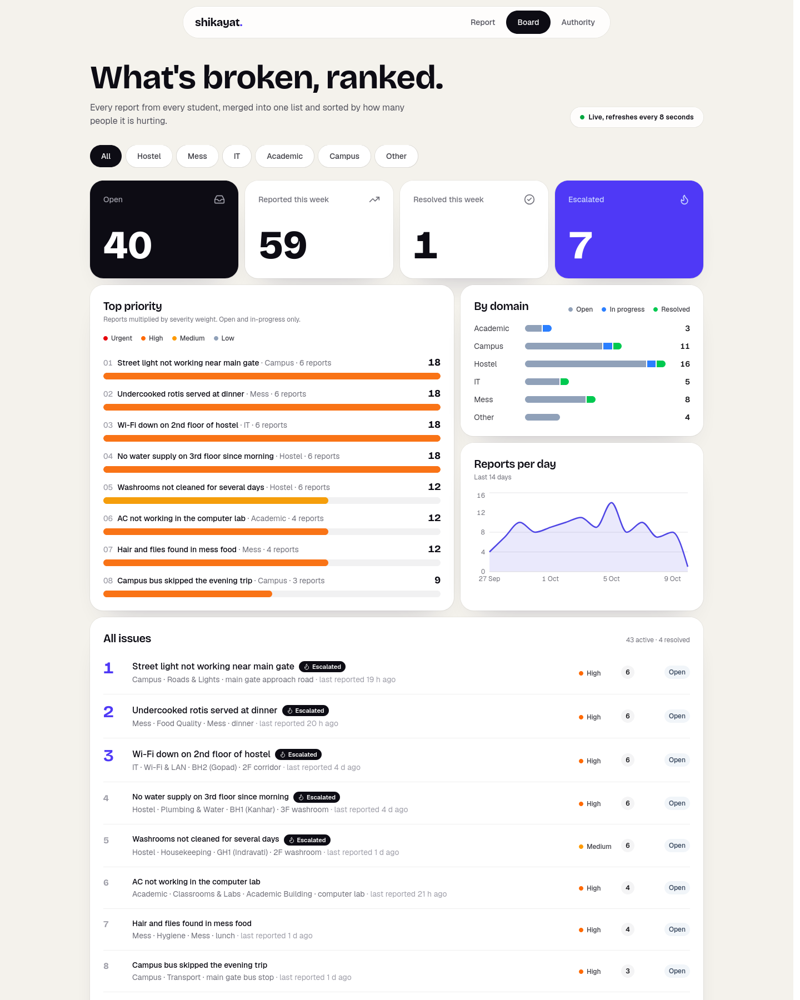

# Shikayat: campus complaints that count

A student reports a campus problem in English, Hinglish or Hindi, optionally with a photo.
**Gemma 4** buckets it, summarises it, works out whether it is already open, merges duplicates,
and **asks the student back** when something an authority actually needs is missing.
A public board ranks issues by how many students are hitting them; each authority sees only its own queue.

> Complaint portals already exist. They make you fill forms and bury wardens in duplicates.
> Ours takes a Hinglish rant or a photo, works out whether it's already been reported, and asks back when it's unsure.



## The model

`gemma-4-26b-a4b-it`, through the Gemini API. Every call in the project goes through one helper,
`gemma_client.generate_raw`:

```python
# gemma_client.py
get_client().models.generate_content(model=MODEL, contents=contents, config=config)
#                                    MODEL = "gemma-4-26b-a4b-it"
```

## What's in the app

- **Report** — type or paste a complaint, attach a photo, watch Gemma's steps, answer if it asks back.
- **Board** — public ranking by priority (reports x severity weight), charts, domain filters and search. Refreshes every 8 seconds, so a merged report moves up by itself.
- **Authority** — pick a role (Hostel Office, Mess Committee, IT Cell, ...) to see only that queue, with every raw report, photo and follow-up answer, and mark issues in progress or resolved.

Light and dark themes; the Report page works on a phone.

## How to run

```bash
python -m venv .venv && ./.venv/bin/pip install -r requirements-dev.txt
cp .env.example .env            # then add a line: GEMINI_API_KEY=your-key
                                # free key: https://aistudio.google.com

./.venv/bin/python -m api.seed --reset           # load seed data into data/shikayat.db
./.venv/bin/uvicorn api.main:app --reload        # API on http://localhost:8000
cd web && npm install && npm run dev             # UI on http://localhost:5173
```

On Windows the venv programs are in `.venv\Scripts\` instead of `.venv/bin/`.
The Vite server also listens on the network, so a phone on the same Wi-Fi can open
`http://<laptop-ip>:5173`.

One complaint, straight from the terminal:

```bash
./.venv/bin/python -m complaints.cli "aaj lunch mein dal mein keeda tha" --photo demo/photos/mess-thali.jpg
./.venv/bin/python -m complaints.cli "AC se paani tapak raha hai"        # Gemma asks which hostel and room
```

Tests: `./.venv/bin/python -m pytest harness` (no key and no internet needed — it uses a fake model).

Other checks:

```bash
./.venv/bin/python -m complaints.eval            # seed/test_cases.json through the real agent, pass/fail table
./.venv/bin/python seed/validate_seed.py         # seed data rules
./.venv/bin/python tools/check_shikayat.py       # our pre-submission gate
./.venv/bin/python tools/check_submission.py     # the organisers' gate
```

## What we changed in the harness and why

The workshop starter ships a small tool-calling harness: `Agent.run(question)` loops until the
model stops asking for tools, then returns a string. It is text-only, stateless, sends every
registered tool on every call, and **always needs one extra model round just to write a final
answer**. Triaging a complaint that way costs four Gemma calls.

We rebuilt the loop around what a real triage flow actually needs. All of this is in
[`harness/agent.py`](harness/agent.py) and [`harness/tools.py`](harness/tools.py), with
`run()` kept byte-for-byte compatible so old callers and the starter's own tests still pass.

| # | What we added | Why |
|---|---|---|
| 1 | **Per-agent tool sets** — `Agent(tools=["find_similar", "merge_into"])` | Sending all tools invites the model into irrelevant ones. Our triage agent sees five tools, not everything registered in the process. |
| 2 | **Image input** — `run_task(question, image_path=...)` | A photo of an insect on a plate *is* the evidence. We send it as an inline `types.Part.from_bytes`, and fall back to `client.files.upload` if the API refuses inline bytes. |
| 3 | **Terminal tools** — `@tool(stop=True)` | `file_new`, `merge_into` and `reject` finish the job. A successful call ends the run and returns its own result, so there is no extra "now write an answer" round. **This is the change that halves the call count.** |
| 4 | **Pause for a human** — `@tool(pause=True)` + `Agent.resume(state, answer)` | Gemma needs to be able to ask the student "which hostel and room?" and then carry on in the *same* conversation. The run returns `status="needs_input"` with the question, and resuming appends the answer and continues. |
| 5 | **Step labels** — every step carries a readable `label` | The Report page shows "Looking for similar reports in Mess" while the student waits, instead of a dead spinner. |
| 6 | **`RunResult`** — `{status, tool, result, question, steps, state}` | A string cannot say "I paused and need an answer". The API maps this straight onto `ReportResult`. |

**The result: a complaint costs 2 Gemma calls instead of 4.** One to pick a bucket and look for
duplicates, one to decide. `harness/test_upgrades.py::test_terminal_tool_ends_the_run_with_no_extra_model_call`
asserts the call count directly.

An error is a first-class part of the design rather than a failure: a `stop` or `pause` tool
whose result starts with `"Error"` does **not** end the run, so the model sees the problem and
tries again. That is how the rules Gemma must not be trusted with are enforced in code — at most
two questions per report, no merging into a complaint id it was not just shown, and never setting
priority or escalation itself. See [`complaints/tools.py`](complaints/tools.py).

Honest limitation: paused conversations live in an in-memory dict keyed by `thread_id`
(`harness.THREADS`). Restarting the server loses half-finished reports. For a demo that is a fair
trade for having no extra moving parts; production would put them in Redis or a `threads` table.
In the same spirit, photos are saved on local disk in `uploads/` (production would use object
storage such as S3 or Cloud Storage), and the Authority page uses a role picker rather than a
login (a real version would use institute SSO).

Tests: 34 of them, all using a fake `generate`, so `python -m pytest harness` needs no API key
and no internet.

## Architecture

```
React (Vite)  --/api-->  FastAPI (api/)  -->  complaints/agent.py  -->  harness/Agent  -->  Gemma 4 (Gemini API)
     ^                       |                       | tools
     +---- JSON -------------+                       v
                             +-->  SQLite (data/shikayat.db)  <--  complaints/tools.py (via api/db.py)
photos: uploads/<uuid>.jpg, served at /uploads/...
```

## Team

Built at OpenLake x MLH Hack Day, IIT Bhilai, on 10 October 2026.

| Who | GitHub | What they built |
|---|---|---|
| Sarthak Shrivastava | [@sarthak0707git](https://github.com/sarthak0707git) | Harness upgrades, the Gemma triage agent and prompt, FastAPI + SQLite, seed data, submission gate |
| Vedant | [@xtacy-on-code](https://github.com/xtacy-on-code) | The entire web app: shell and design system, Report, Board and Authority pages |
| Sumagna Das | [@sumagnadas](https://github.com/sumagnadas) | The agent skill: `SKILL.md`, the bucket reference, and the `triage_check.py` validator |
| Devanshu Sabharwal | [@DeathSlash945](https://github.com/DeathSlash945) | README and project write-up |
| Neil | [@Neil-ctrl](https://github.com/Neil-ctrl) | Presentation, demo photos, backup video and submission |

## AI tools disclosure

MLH asks teams to disclose the AI tools they used. We used **Claude Code** (Anthropic) while
building this, alongside the Gemma 4 model that powers the product itself. Lighter assistants
were used by some team members for their own files. All design decisions, the brief, the
harness upgrades and the prompt rules are ours.

## License

MIT — see [LICENSE](LICENSE).
